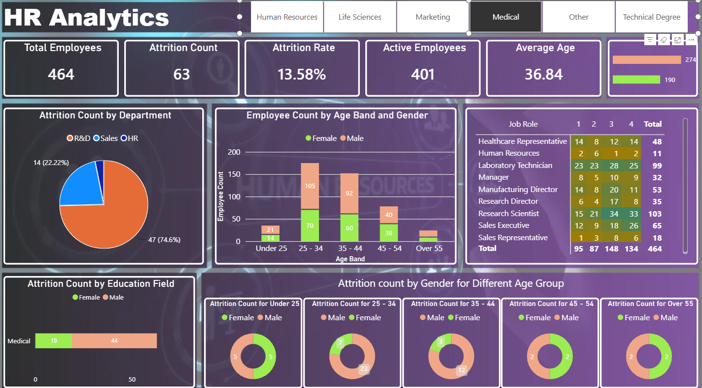
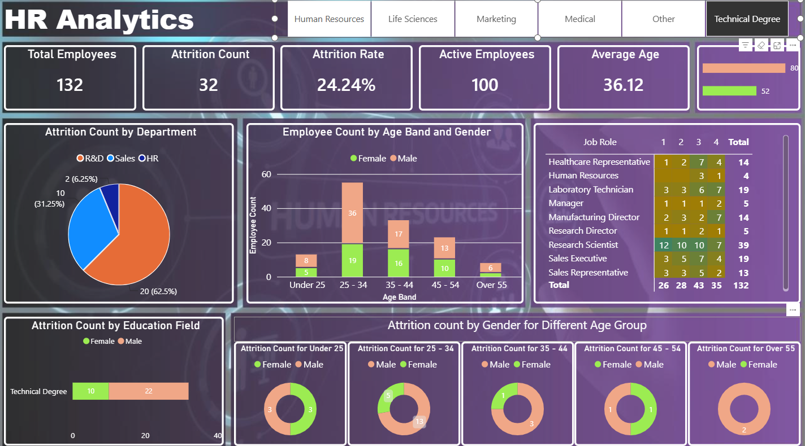
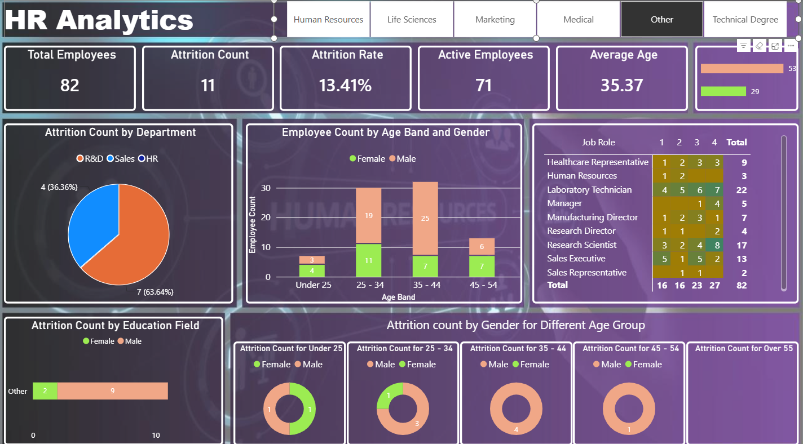

# HR Attrition Analysis — Power BI Dashboard

An interactive one-page Power BI dashboard that analyses employee attrition for a 1,470-person company. It answers the questions an HR manager asks: *how many people are leaving, which departments, roles and age groups are most affected, and how do men and women compare?*




*The screenshot shows the dashboard filtered to the Medical education field. Use the buttons at the top to switch between education fields.*

---

## Headline numbers

Whole dataset (all education fields).

| KPI | Value |
|---|---|
| Total Employees | **1,470** |
| Attrition Count | **237** |
| Attrition Rate | **16.1%** |
| Active Employees | **1,233** |
| Average Age | **36.9** |

## Key insights

- **Overtime is the biggest warning sign.** 30.5% of employees who work overtime leave, against 10.4% of those who do not.
- **Sales Representatives have the highest attrition by role (39.8%)**, followed by Laboratory Technicians (23.9%) and HR staff (23.1%). Research Directors (2.5%) and Managers (4.9%) rarely leave.
- **Young employees leave most.** Attrition is 39.2% for under-25s and 20.2% for 25–34, falling to about 10% for the 35–54 groups.
- **Research & Development contributes the most leavers (133 of 237)**, but Sales has the higher rate (20.6% against 13.8% in R&D).
- **Single employees leave at 25.5%**, twice the rate of married (12.5%) and divorced (10.1%) staff.
- **Frequent business travel raises attrition to 24.9%**, against 8.0% for people who do not travel.
- **Leavers are paid less and are newer.** Median monthly income is 3,202 for leavers against 5,204 for stayers, and median tenure is 3 years against 6.
- **Men leave slightly more than women** (17.0% against 14.8%).

## Dashboard features

- **KPI cards** for Total Employees, Attrition Count, Attrition Rate, Active Employees, Average Age and a Male / Female headcount bar
- **Education Field buttons** that filter the whole page to Human Resources, Life Sciences, Marketing, Medical, Other or Technical Degree
- **Attrition Count by Department** (pie) and **Attrition Count by Education Field** (stacked bar by gender)
- **Employee Count by Age Band and Gender** (stacked column)
- **Job Role × Job Satisfaction matrix** (ratings 1–4) with heat-map colouring
- **Attrition by Gender for each Age Group**: five donut charts, one per age band
- Custom dark and purple theme with a background image and bordered cards

## What I did

1. **Prepared the data (Power Query):** loaded the HR dataset and added helper columns for the age band (`CF_age band`), the current / ex-employee label (`CF_attrition label`) and an active-employee flag (`CF_current Employee`).
2. **Wrote DAX measures** for Total Employees, Attrition Count, Attrition Rate, Active Employees and Average Age.
3. **Designed the layout** around a KPI row, four analysis visuals and a gender-by-age drill-down, with a custom background.
4. **Built the education-field button filter** so the whole page responds to one click.
5. **Used heat-map conditional formatting** in the job-role matrix to highlight where satisfaction scores cluster.

## Dataset

[`data/HR-Data.xlsx`](data/HR-Data.xlsx): 1,470 rows × 39 columns, covering 3 departments, 9 job roles and 6 education fields. This is a fictional sample HR attrition dataset used for training. It contains no real employees or personal data.

| Column group | Examples |
|---|---|
| Employee profile | Age, Gender, Marital Status, Education, Education Field |
| Job details | Department, Job Role, Job Level, Business Travel, Over Time |
| Pay and career | Monthly Income, Percent Salary Hike, Stock Option Level, Years At Company, Years Since Last Promotion |
| Satisfaction scores | Job Satisfaction, Environment Satisfaction, Work Life Balance, Relationship Satisfaction |
| Outcome | Attrition (Yes / No) |

## Repository structure

```
├── report/
│   └── HR-Attrition-Analysis.pbix    # Dashboard
├── data/
│   └── HR-Data.xlsx                  # Source data
├── assets/                           # Background images used in the report
└── images/                           # Dashboard screenshots
```

## More screenshots




## How to open

1. Install [Power BI Desktop](https://www.microsoft.com/power-platform/products/power-bi/desktop) (free).
2. Download `report/HR-Attrition-Analysis.pbix` and open it.
3. If you are asked for the data source, point it to `data/HR-Data.xlsx` and refresh.

---

Built by **Bukhtawar Ali** as part of the *AI-Powered Analytics with Power BI* course (EduHubSpot), 2026.
[LinkedIn](https://www.linkedin.com/in/bukhtawar-ali-4441291a9) · [Portfolio](https://bukhtawarali110.github.io) · [GitHub](https://github.com/BukhtawarAli110)

## Licence

MIT, see [LICENSE](LICENSE). The report, DAX and documentation are mine; the dataset belongs to its original publisher.
